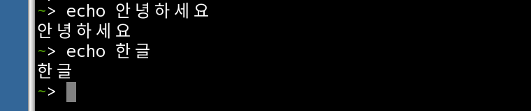
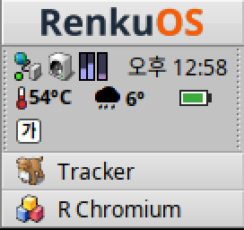

# RenkuOS 한국어 입력기

[한국어](README.md) | [English](README.en.md)

RenkuOS용 한국어 입력기(두벌식)입니다. RenkuOS 응용 프로그램, 터미널,
R Chromium에서 한글을 입력할 수 있으며, R Chromium에서는 웹 페이지가 조합
이벤트(`KeyboardEvent.isComposing`)를 제대로 받습니다. 설치하면 시스템 언어도
한국어로 바뀝니다.

 

## pkgman으로 설치

| RenkuOS | 명령 |
| --- | --- |
| 32비트 x86 (x86_gcc2) | `pkgman add-repo https://pkgman.rainygirl.com/x86_gcc2`<br>`pkgman install koreanime` |
| x86_64 | `pkgman add-repo https://pkgman.rainygirl.com/x86_64`<br>`pkgman install koreanime` |
| arm64 | `pkgman add-repo https://pkgman.rainygirl.com/arm64`<br>`pkgman install koreanime` |

이것으로 끝입니다. 설치하면:

- 표시 언어와 형식 규칙이 한국어(ko, ko_KR)로 바뀝니다. 이미 한국어인
  시스템은 그대로 둡니다.
- 입력기가 바로, 그리고 부팅할 때마다 스스로 켜집니다. 영문을 입력할 때는
  Deskbar에 **A**, 한글을 입력할 때는 **가**가 보입니다. 이 아이콘은 화면
  배율에 맞춰 그려지므로 고해상도(HiDPI) 화면에서도 선명하며, 시스템의 작은
  입력기 아이콘을 대신합니다.

## 한글 입력하기

| | |
| --- | --- |
| 한글 / 영문 전환 | **한/영** 키, **오른쪽 Alt** 한 번 누르기, 또는 **Shift+Space** |
| 자판 | 표준 두벌식. Shift로 ㅃ ㅉ ㄸ ㄲ ㅆ ㅒ ㅖ |
| Backspace | 조합 중인 글자의 마지막 자모를 지웁니다 |
| 모드 메뉴 | Deskbar 아이콘을 누릅니다 |

**Alt+Space**는 입력기를 바꾸는 RenkuOS 자체 단축키입니다. 한글 입력이 되지
않으면 Alt+Space를 한 번 눌러 이 입력기로 돌아오십시오.

## 동작하는 곳

- **글자를 입력하는 모든 곳**: 별도의 입력 창 없이 커서 위치에서 글자가
  조합됩니다. RenkuOS 응용 프로그램(StyledEdit, Mail, Tracker 등
  BTextView를 쓰는 프로그램), 터미널, 입력기를 지원하지 않는 프로그램
  모두 같습니다.
- **R Chromium** 154.0.8036.0-18 이상(x86_64, arm64), rchromium_x86
  114.0.5735.199-18 이상(32비트 x86): 웹 페이지가 compositionstart /
  compositionupdate / compositionend와, `isComposing`이 켜지고 key가
  "Process"인 keydown을 다른 시스템의 Chrome과 똑같이 받습니다. 글자를
  조합하다 Enter를 누르면 마지막 글자가 두 번 들어가는 일 없이 전체가
  전송됩니다.

## 언어

```sh
koreanime-setup --status     # 지금 언어와 형식 규칙
koreanime-setup --english    # 영어로 되돌리기
koreanime-setup              # 다시 한국어로
```

## 소스에서 설치

RenkuOS 기기에서(32비트 x86에서는 기본 gcc2 컴파일러로):

```sh
make install       # 입력기와 koreanime-setup을 이 사용자에게 설치
make uninstall
make test          # 조합기 테스트
```

## AI 사용 고지

이 입력기의 일부는 AI 코딩 도구(Anthropic Claude)의 도움을 받아
개발했습니다. 모든 코드는 작성자가 검토하고 테스트했습니다.

## 라이선스

MIT. 개발 기록은 [AGENTS.md](AGENTS.md)에 있습니다.
